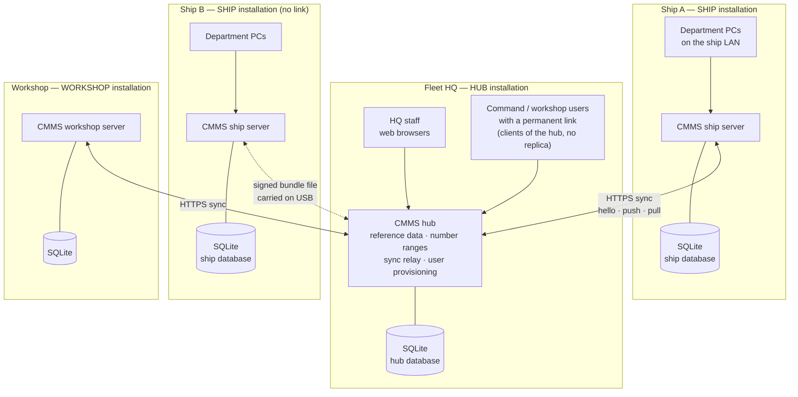
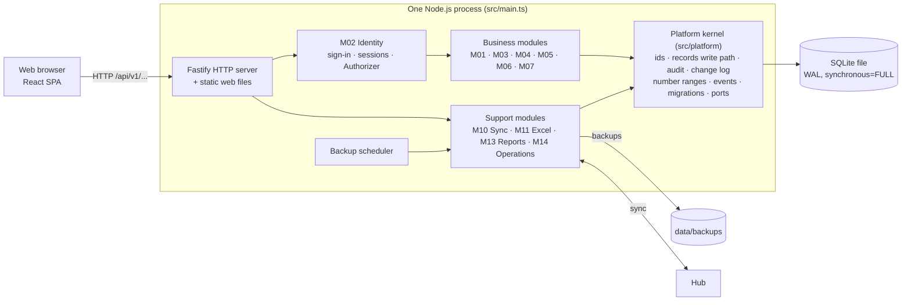
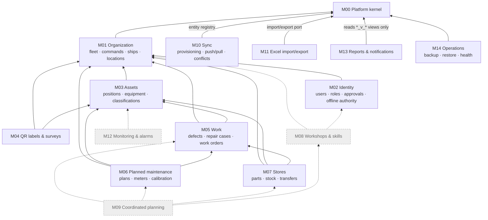
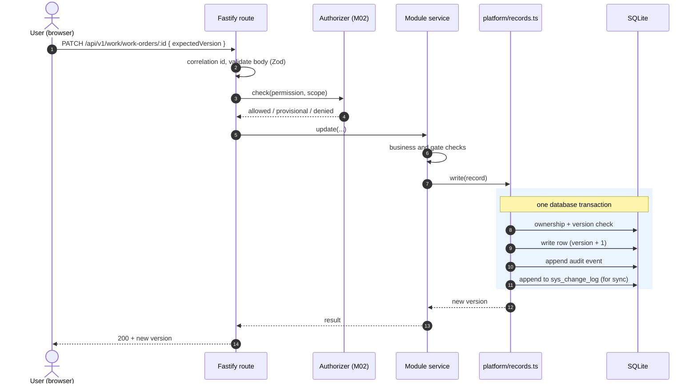
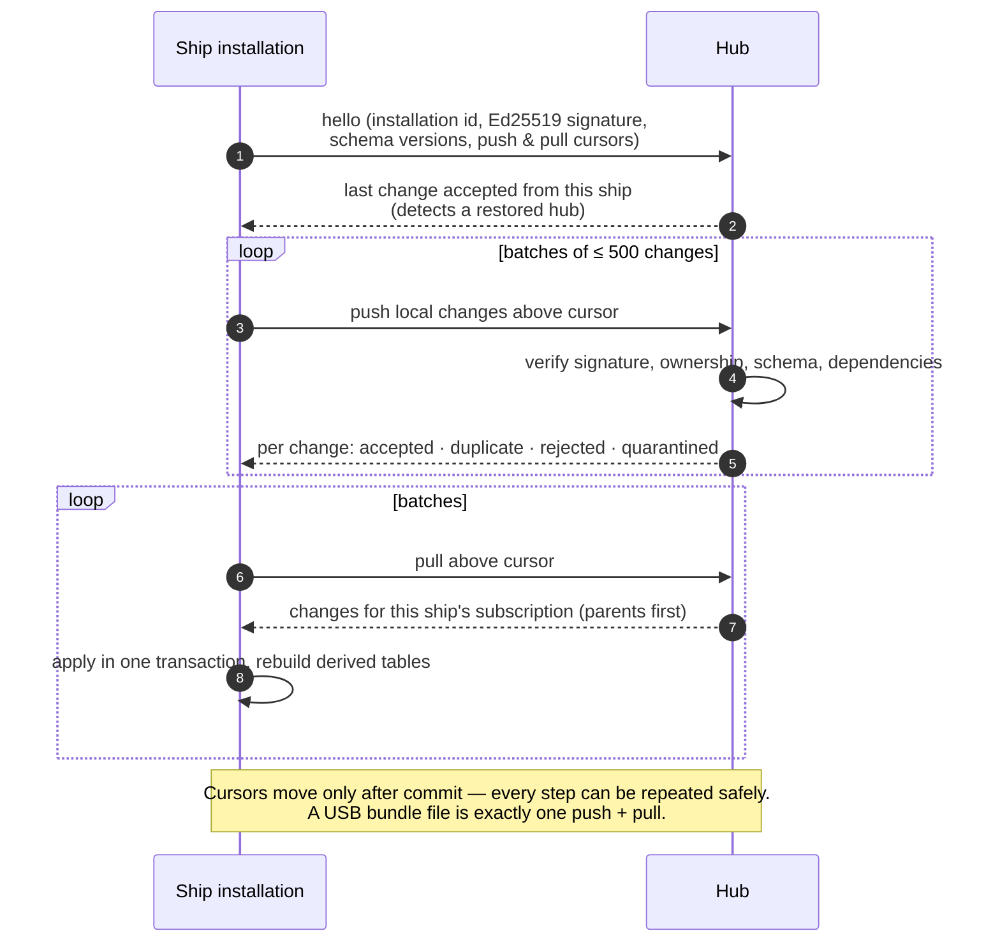
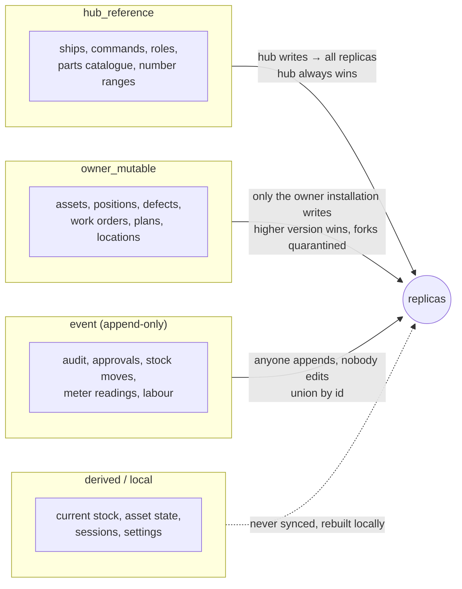
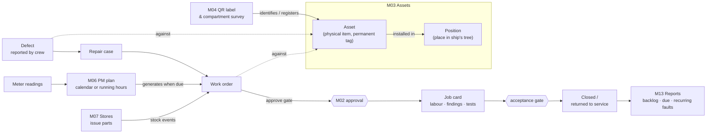
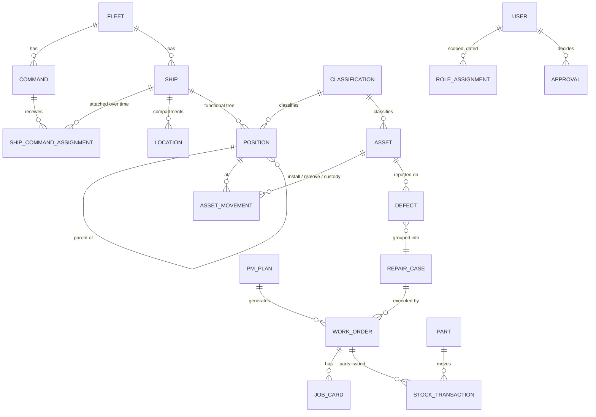
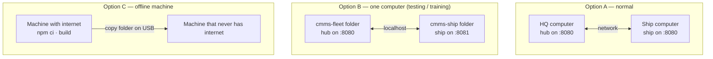

# Ship & Fleet CMMS — Architecture in Diagrams

A picture-first tour of the system for people new to it. The diagrams render directly on GitHub (Mermaid). For the full rules behind each picture see [ARCHITECTURE.md](ARCHITECTURE.md), [MODULE_MAP.md](MODULE_MAP.md), [SYNC_RULES.md](SYNC_RULES.md) and [DATA_DICTIONARY.md](DATA_DICTIONARY.md).

**In one sentence:** every ship (and, where needed, workshop or command) runs its own complete copy of the CMMS on a local computer, works fully offline, and exchanges changes with a central hub at headquarters over the network or by USB file when a link is available.

---

## 1. The fleet: hub and spoke

- Replicas never talk to each other directly — the hub relays everything.
- The network link and the USB file carry the **same signed change envelope**, so a ship with no link at all still exchanges data.
- Each installation is **one Node.js process + one SQLite file**. Nothing runs in the cloud, nothing needs internet.

---

## 2. Inside one installation

| Layer | Where | Technology |
|---|---|---|
| Web UI | `web/` | React 19, React Router, Vite — bundled, no CDN |
| HTTP / API | `src/app.ts`, each module's `routes.ts` | Fastify 5, Zod 4 validation |
| Business logic | `src/modules/mNN-*/service.ts` | TypeScript (strict, ESM) on Node.js 22 |
| Kernel | `src/platform/` | shared by all modules, imports none of them |
| Storage | one SQLite file per installation | better-sqlite3, forward-only SQL migrations |

---

## 3. Modules and how they depend on each other

Arrows point from a module to the module it uses. Grey boxes are planned for Release 2.

Rules that keep the modules independent (checked automatically by `npm run check:boundaries`):

1. A module imports only the platform, itself, and the public `index.ts` of modules it declares as dependencies.
2. Each module owns its own tables (prefix `org_`, `ast_`, `wrk_`, …). Others read them only through public functions or published `<prefix>_v_*` views.
3. Where a dependency would point the wrong way, modules talk through **ports** registered at start-up (Authorizer, ApprovalPort, ImportExportPort, entity registry, event bus).

---

## 4. What happens on every change (request flow)

Every write to synchronized data goes through this one path, so audit and sync can never be forgotten.

---

## 5. Synchronization

### 5.1 One sync session

### 5.2 Who may change what

Conflicts are rare by design: one writer per record, append-only events, and every number (tags, work-order numbers) comes from a range the hub granted in advance so ships can number offline.

---

## 6. The maintenance workflow

- **Position ≠ asset**: the ship's functional tree (system → equipment group → equipment → component) stays; physical assets are installed, removed and transferred over time but keep their permanent tag.
- Approvals still work offline under an **authority lease** (30 days by default). After it expires, reviews and approvals become *pending confirmation* until the next hub sync.

---

## 7. Core data at a glance

---

## 8. Deployment options

Install, backup, restore and upgrade steps: [OPERATIONS.md](OPERATIONS.md). Everyday use: [USER_GUIDE.md](USER_GUIDE.md).

---

## Release status

| Release | Modules | Status |
|---|---|---|
| R1 — Disconnected core | M00–M07, M10, M11, M13, M14 | **done** |
| R2 — Coordination | M08 workshops, M09 planning, M12 monitoring, readiness & cost reports | planned |
| R3 — Integration | read-only PLC connectors, notifications beyond the app | planned |

Detail per module: [BUILD_STATUS.md](BUILD_STATUS.md).
